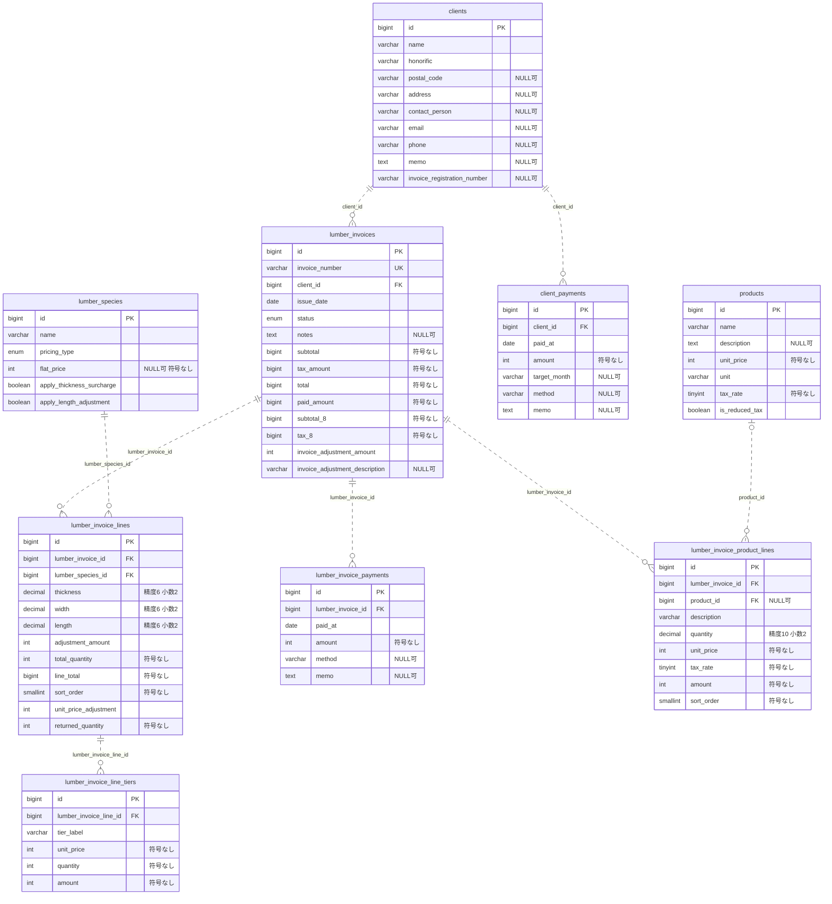
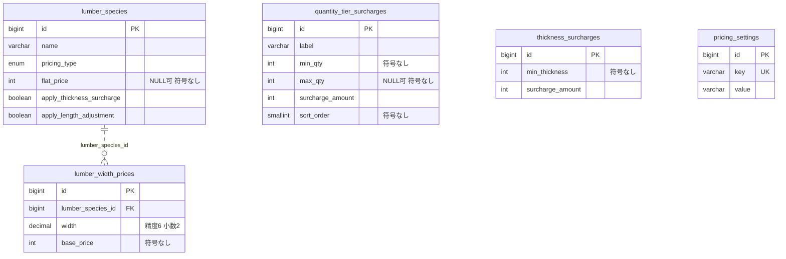
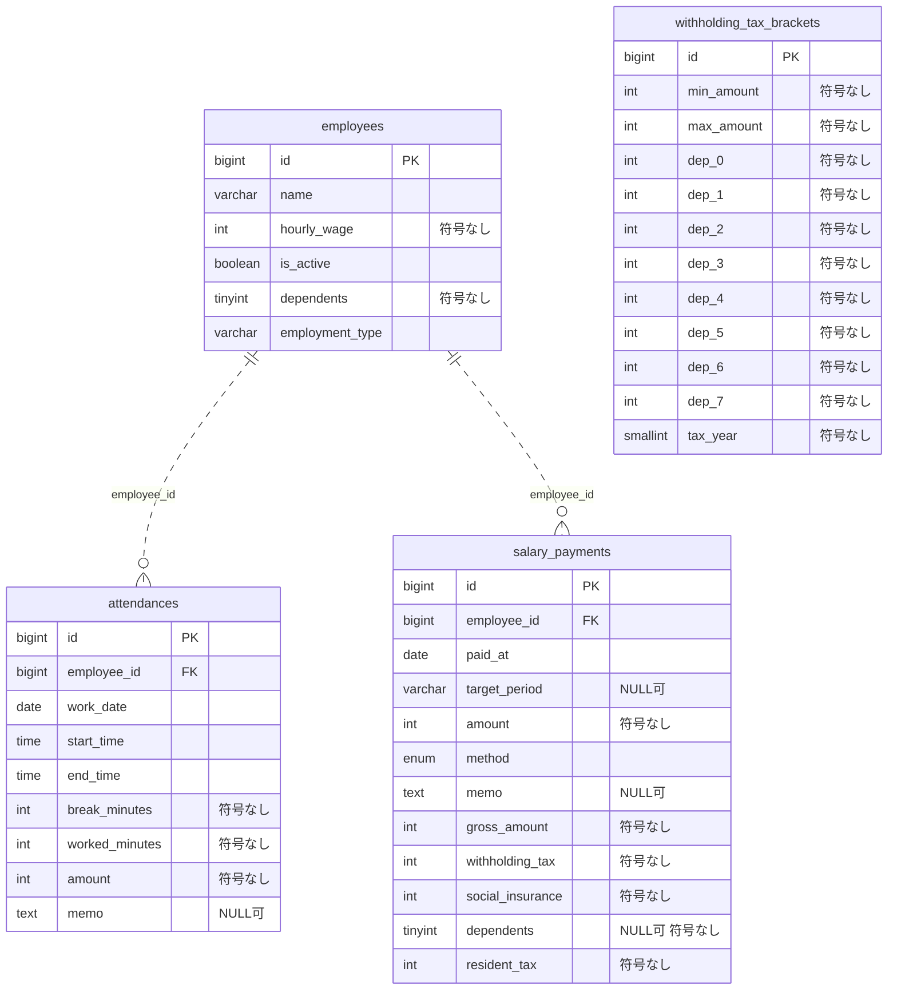
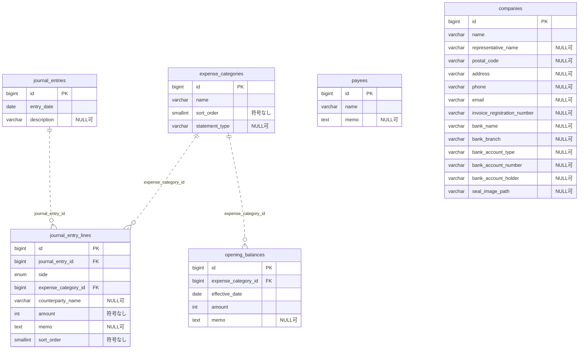

# ER図・テーブル構成

全体を1枚にまとめた編集用ファイル：[draw.io形式でダウンロード](er-diagram.drawio)。draw.ioの「ファイル → ファイルを開く → デバイス」から開いてください。

公開版 Solo Backoffice のマイグレーションを最後まで適用した状態を表しています。実データは含みません。

## 図の読み方

- `PK`：主キー、`FK`：DBに定義された外部キー、`UK`：単一カラムの一意制約。
- `||`：必ず1件、`o|`：0または1件、`o{`：0件以上。親に対する子の件数はDB制約で表しています。
- 点線は非識別関係です。子テーブルは独立した主キー`id`を持ち、外部キーを主キーに含めません。点線もDBの外部キーを表し、アプリ上だけの参照とは区別しています。
- 図では共通の`created_at`・`updated_at`を省略しています。ここに掲載する業務テーブルには両方のカラムがあります。
- 型名は読みやすい表記に簡略化しています。桁数・デフォルト値・削除時の動作など、厳密なDDLは[マイグレーション](../database/migrations)を参照してください。

## 1. 納品・入金

`lumber_invoices`は画面上の「納品書」です。月次請求書は納品データを集計して作成し、専用の月次請求書テーブルはありません。

取引先別入金と納品書別入金は別のテーブルで、両者を結ぶ外部キーはありません。

## 2. 単価マスタ

厚み加算・数量帯加算・単価設定は計算時に参照する独立マスタです。数量帯別明細はマスタIDではなく、`tier_label`と計算済みの`unit_price`を保存します。

## 3. 勤怠・給与

勤怠と給与支払いは従業員に紐付きます。給与支払いから個別の勤怠行を参照する外部キーはありません。対象月の勤怠を集計し、支払い時の金額・控除額・扶養人数を保存します。

税額表は年・給与額・扶養人数を使って検索するため、給与支払いとの外部キーはありません。`amount`は差引支給額、`gross_amount`は控除前の支給額です。

## 4. 会計・共通マスタ

`expense_categories`は名称にexpenseを含みますが、現在は売上・資産・負債なども含む勘定科目マスタです。出納帳・総勘定元帳・決算書は仕訳や期首残高を集計して表示するため、帳票ごとのテーブルはありません。

支払先は入力候補として使われ、仕訳明細には名前を`counterparty_name`として保存します。`payee_id`はありません。事業者情報も帳票出力時に参照する独立テーブルです。

## アプリケーション上の仕訳連携（外部キーではない）

| 登録元 | 振替伝票の識別方法 |
| --- | --- |
| `client_payments` | `journal_entries.description`に`入金:client_payment_{id}`を保存 |
| `salary_payments` | `journal_entries.description`に`給与:salary_payment_{id}`を保存 |

モデルの`syncJournalEntry()`・`deleteJournalEntry()`が、この文字列で対応する伝票を検索します。DBが1対1を保証する関係ではないため、ER図に外部キーの線は引いていません。納品書別の`lumber_invoice_payments`には同じ自動仕訳メソッドはありません。

## 複合一意制約と入力チェック

| 対象 | 制約・検証 |
| --- | --- |
| `lumber_width_prices` | DBの複合一意制約：`lumber_species_id`＋`width` |
| `opening_balances` | DBの複合一意制約：`expense_category_id`＋`effective_date` |
| `attendances` | 同一従業員・勤務日の重複はアプリの入力検証で防止（DBの複合一意制約はなし） |
| `salary_payments` | 同一従業員・対象月の重複はアプリの入力検証で防止（DBの複合一意制約はなし） |

## フレームワーク用テーブル・削除済みテーブル

業務ER図からは、Laravel標準の`users`、`password_reset_tokens`、`sessions`、`cache`、`cache_locks`、`jobs`、`job_batches`、`failed_jobs`およびマイグレーション管理用の`migrations`を省略しています。認証画面は現状未実装です。`sessions.user_id`にはインデックスはありますが、DBの外部キー制約はありません。

旧支出管理の`expenses`は後続マイグレーションで削除されるため、現行ER図に含めていません。

## テーブル名と用途

| テーブル | 用途 |
| --- | --- |
| `companies` | 事業者情報 |
| `clients` | 取引先 |
| `products` | 品目 |
| `lumber_species` | 樹種 |
| `lumber_width_prices` | 幅別単価 |
| `quantity_tier_surcharges` | 数量帯加算 |
| `thickness_surcharges` | 厚み加算 |
| `pricing_settings` | 単価設定 |
| `lumber_invoices` | 納品書 |
| `lumber_invoice_lines` | 木材明細 |
| `lumber_invoice_line_tiers` | 数量帯別明細 |
| `lumber_invoice_product_lines` | 品目明細 |
| `lumber_invoice_payments` | 納品書別入金 |
| `client_payments` | 取引先別入金 |
| `employees` | 従業員 |
| `attendances` | 勤怠 |
| `salary_payments` | 給与支払い |
| `withholding_tax_brackets` | 源泉徴収税額表 |
| `journal_entries` | 振替伝票 |
| `journal_entry_lines` | 仕訳明細 |
| `expense_categories` | 勘定科目 |
| `opening_balances` | 期首残高 |
| `payees` | 支払先 |

旧見積・請求テーブル（`estimates`、`estimate_items`、`invoices`、`invoice_items`、`payments`）は、整理用マイグレーションですべて空であることを確認して削除します。1件でもデータがあれば、削除開始前に処理を中止します。作成時のマイグレーションは既存環境の履歴とロールバックのため保持しています。
